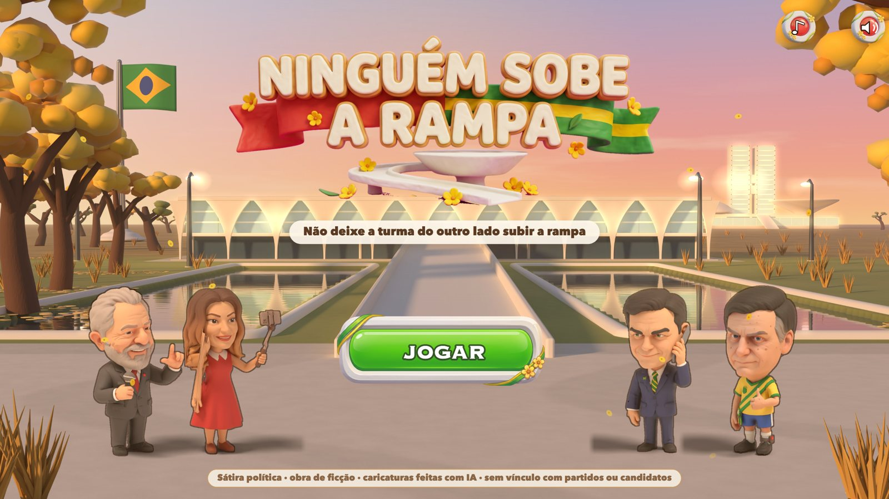
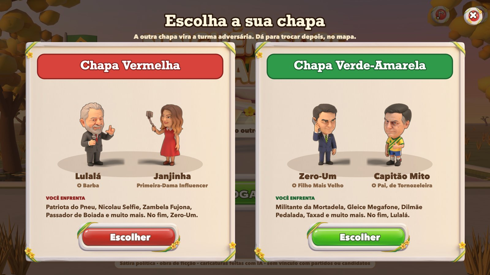
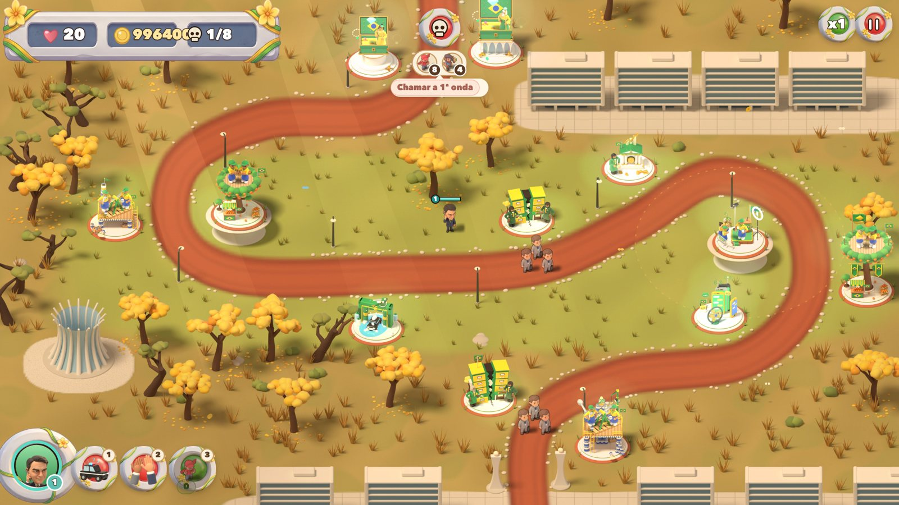
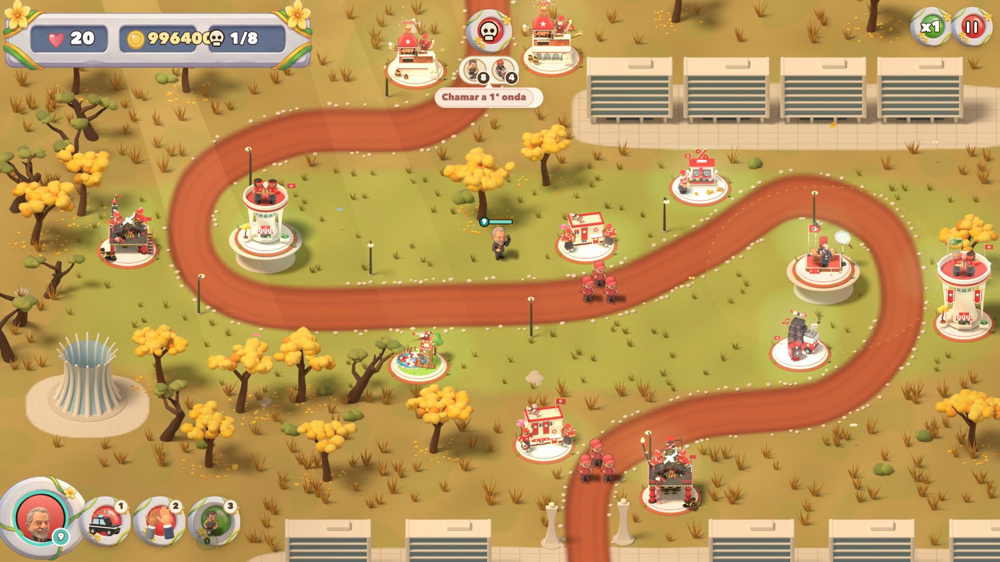

# Ninguém Sobe a Rampa

**Sátira política em forma de tower defense**, jogável no navegador. Você escolhe uma chapa e defende a rampa do
Planalto com o arsenal do seu próprio lado. A outra chapa vira a turma adversária, que tenta subir a rampa de qualquer
jeito.

> **Sátira política · obra de ficção · caricaturas feitas com IA · sem vínculo com partidos ou candidatos.**
> Os personagens são caricaturas de figuras públicas, com nomes trocados. As piadas vêm de casos públicos e memes
> conhecidos. Não há crime inventado, e os dois lados apanham com o mesmo peso.

## Como jogar

- **No navegador:** abra o `index.html` (não precisa de servidor nem de instalação). Se o GitHub Pages estiver
  ligado, o jogo fica em `https://netoonine.github.io/ninguem-sobe-a-rampa/`.
- **No jogo:** escolha a chapa, construa torres nos lotes de concreto, evolua e especialize cada uma, use as operações
  e o herói. Ninguém pode chegar ao topo da rampa.

## As duas chapas

Cada chapa tem os próprios heróis, as próprias torres e a própria turma adversária.

| Função | Chapa Vermelha | Chapa Verde-Amarela |
|---|---|---|
| Heróis | Lulalá e Janjinha | Zero-Um e Capitão Mito |
| Tiro rápido | Mensalinho | Laranjal |
| Dano em área | Churrascão da Picanha | Joias da Arábia |
| Bombardeio | Petrolão | Leite Condensado |
| Tropas | Sindicato | Rachadinha |
| Água | Pedalinho do Sítio | Lava a Jato |
| Empurrão | Carro de Som do Comício | Central do Zap |
| Reforço | CPI | Live do Cercadinho |
| Verba | Taxa das Blusinhas | Banco Vorcash |

Além disso, 5 fases em Brasília (Eixo Monumental, Esplanada, Congresso, Praça dos Três Poderes e a Rampa do
Planalto), dezenas de adversários e chefes, operações (Operação da PF, Bancada de Apoio, Delação Premiada), melhorias,
desafios e o modo Recontagem.

## Como foi feito

- **Jogo:** JavaScript puro em Canvas 2D (`js/`), sem dependências.
- **Arte 3D pré-renderizada:** torres, cenários, ícones e efeitos são modelados por código Python e renderizados em
  sprites no Blender, em modo headless (`tools/blender/`). As cores de cada chapa saem de `tools/blender/chapa.py`
  (`CHAPA=V` ou `CHAPA=R`).
- **Personagens:** caricaturas geradas com IA. O conceito sai de uma foto pública com um prompt de roupa e adereço,
  vira modelo 3D e recebe um esqueleto automático em `tools/blender/rampa_glb.py`.
- **Empacotamento:** `tools/sprites/empacotar.py` gera as folhas das torres (`CHAPA=R` para a Vermelha), e
  `tools/sprites/empacotar_inimigos.py` gera as dos personagens.
- **Testes:** `tools/e2e.js` (Puppeteer) joga clicando como uma pessoa, e `tools/sim.js` é um robô de balanceamento.

Os modelos 3D, os quadros de render intermediários e as fotos de referência não estão no repositório. São pesados ou
têm licença própria.

## Licença

- **Código:** MIT (`LICENSE`).
- **Arte:** CC BY-NC-SA 4.0 (`LICENSE-ASSETS.md`). Pode remixar com crédito, sem uso comercial e mantendo a mesma
  licença.
